<!-- product-brand:start -->
<h1 align="center">
  <picture>
    <source media="(prefers-color-scheme: dark)" srcset="brand/superintelligence-logo-dark.svg">
    
  </picture>
</h1>
<p align="center"><strong>A visual language for AI products.</strong></p>
<!-- product-brand:end -->

<!-- Generated from README.md by scripts/readmes.mjs. Edit README.md, then regenerate. -->

Isometric icons for the systems AI teams build and the agents they use. From MCP, RAG, and orchestration to Hermes, Claude, OpenAI, Meta Muse, and DeepSeek, give your dashboard, documentation, or developer tool one consistent visual language.

**68 icons · 5 styles · 340 SVGs**

<!-- style-navigation:start -->
**Browse styles:** [**Stroke**](README-stroke.md) · [Two-tone](README-two-tone.md) · [Duotone](README-duotone.md) · [Fill](README-fill.md) · [Color](README.md)
<!-- style-navigation:end -->

[Agents & platforms](#agents--platforms) · [AI systems](#ai-systems) · [Choose a style](#five-styles-one-system) · [Get started](#get-started) · [License](LICENSE)

<p align="center">
  <a href="icons/stroke/hermes.svg"></a>
  <a href="icons/stroke/grok.svg"></a>
  <a href="icons/stroke/meta-muse.svg"></a>
  <a href="icons/stroke/claude.svg"></a>
  <a href="icons/stroke/openai.svg"></a>
</p>

## Built for teams shipping AI

- **Systems and the tools behind them.** 48 AI concepts plus 20 agents and platforms, including Chinese model providers. Dedicated icons for agent swarms, MCP, computer use, human approval, and model architectures.
- **One coherent system.** The same isometric camera, rounded geometry, proportions, and lighting across the collection.
- **Ready for your stack.** Standalone SVG files with transparent backgrounds and no runtime dependencies. Use them in HTML, React, Vue, design tools, or technical docs.
- **Editable, reproducible source.** MIT licensed system icons and presentation code, with source references for the brand marks.

## Five styles, one system

Choose a visual treatment without changing the icon's meaning. Every icon is available in all five styles; click a sample to open its complete README gallery.

| Stroke | Two-tone | Duotone | Fill | Color |
| :---: | :---: | :---: | :---: | :---: |
| <a href="README-stroke.md"></a> | <a href="README-two-tone.md"></a> | <a href="README-duotone.md"></a> | <a href="README-fill.md"></a> | <a href="README.md"></a> |
| Precise linework | White + blue | Lilac + violet | Slate volumes | Full palette |

## The collection

All 68 icons, shown in Stroke. Click any icon or filename to open its SVG.

<!-- style-navigation:start -->
**Browse styles:** [**Stroke**](README-stroke.md) · [Two-tone](README-two-tone.md) · [Duotone](README-duotone.md) · [Fill](README-fill.md) · [Color](README.md)
<!-- style-navigation:end -->

### Agents & platforms

20 recognizable agent and platform marks in a shared isometric presentation. Color uses brand reference colors; the other four styles adapt the marks to the collection's palette. Each includes searchable product metadata and source references in the preview.

[View the agents & platforms contact sheet](previews/brands-stroke-contact-sheet.png)

<table>
  <tbody>
    <tr>
      <td align="center" width="25%">
        <a href="icons/stroke/hermes.svg"></a><br>
        <strong>Hermes Agent</strong><br>
        <sub><a href="icons/stroke/hermes.svg">hermes.svg</a></sub>
      </td>
      <td align="center" width="25%">
        <a href="icons/stroke/grok.svg"></a><br>
        <strong>Grok Bot</strong><br>
        <sub><a href="icons/stroke/grok.svg">grok.svg</a></sub>
      </td>
      <td align="center" width="25%">
        <a href="icons/stroke/meta-muse.svg"></a><br>
        <strong>Meta Muse</strong><br>
        <sub><a href="icons/stroke/meta-muse.svg">meta-muse.svg</a></sub>
      </td>
      <td align="center" width="25%">
        <a href="icons/stroke/claude.svg"></a><br>
        <strong>Claude</strong><br>
        <sub><a href="icons/stroke/claude.svg">claude.svg</a></sub>
      </td>
    </tr>
    <tr>
      <td align="center" width="25%">
        <a href="icons/stroke/openai.svg"></a><br>
        <strong>OpenAI</strong><br>
        <sub><a href="icons/stroke/openai.svg">openai.svg</a></sub>
      </td>
      <td align="center" width="25%">
        <a href="icons/stroke/gemini.svg"></a><br>
        <strong>Gemini</strong><br>
        <sub><a href="icons/stroke/gemini.svg">gemini.svg</a></sub>
      </td>
      <td align="center" width="25%">
        <a href="icons/stroke/perplexity.svg"></a><br>
        <strong>Perplexity</strong><br>
        <sub><a href="icons/stroke/perplexity.svg">perplexity.svg</a></sub>
      </td>
      <td align="center" width="25%">
        <a href="icons/stroke/mistral.svg"></a><br>
        <strong>Mistral</strong><br>
        <sub><a href="icons/stroke/mistral.svg">mistral.svg</a></sub>
      </td>
    </tr>
    <tr>
      <td align="center" width="25%">
        <a href="icons/stroke/copilot.svg"></a><br>
        <strong>GitHub Copilot</strong><br>
        <sub><a href="icons/stroke/copilot.svg">copilot.svg</a></sub>
      </td>
      <td align="center" width="25%">
        <a href="icons/stroke/cursor.svg"></a><br>
        <strong>Cursor</strong><br>
        <sub><a href="icons/stroke/cursor.svg">cursor.svg</a></sub>
      </td>
      <td align="center" width="25%">
        <a href="icons/stroke/openclaw.svg"></a><br>
        <strong>OpenClaw</strong><br>
        <sub><a href="icons/stroke/openclaw.svg">openclaw.svg</a></sub>
      </td>
      <td align="center" width="25%">
        <a href="icons/stroke/manus.svg"></a><br>
        <strong>Manus</strong><br>
        <sub><a href="icons/stroke/manus.svg">manus.svg</a></sub>
      </td>
    </tr>
    <tr>
      <td align="center" width="25%">
        <a href="icons/stroke/deepseek.svg"></a><br>
        <strong>DeepSeek</strong><br>
        <sub><a href="icons/stroke/deepseek.svg">deepseek.svg</a></sub>
      </td>
      <td align="center" width="25%">
        <a href="icons/stroke/qwen.svg"></a><br>
        <strong>Qwen</strong><br>
        <sub><a href="icons/stroke/qwen.svg">qwen.svg</a></sub>
      </td>
      <td align="center" width="25%">
        <a href="icons/stroke/kimi.svg"></a><br>
        <strong>Kimi</strong><br>
        <sub><a href="icons/stroke/kimi.svg">kimi.svg</a></sub>
      </td>
      <td align="center" width="25%">
        <a href="icons/stroke/z-ai.svg"></a><br>
        <strong>Z.ai / GLM</strong><br>
        <sub><a href="icons/stroke/z-ai.svg">z-ai.svg</a></sub>
      </td>
    </tr>
    <tr>
      <td align="center" width="25%">
        <a href="icons/stroke/minimax.svg"></a><br>
        <strong>MiniMax</strong><br>
        <sub><a href="icons/stroke/minimax.svg">minimax.svg</a></sub>
      </td>
      <td align="center" width="25%">
        <a href="icons/stroke/doubao.svg"></a><br>
        <strong>Doubao</strong><br>
        <sub><a href="icons/stroke/doubao.svg">doubao.svg</a></sub>
      </td>
      <td align="center" width="25%">
        <a href="icons/stroke/ernie.svg"></a><br>
        <strong>ERNIE</strong><br>
        <sub><a href="icons/stroke/ernie.svg">ernie.svg</a></sub>
      </td>
      <td align="center" width="25%">
        <a href="icons/stroke/hunyuan.svg"></a><br>
        <strong>Tencent Hunyuan</strong><br>
        <sub><a href="icons/stroke/hunyuan.svg">hunyuan.svg</a></sub>
      </td>
    </tr>
  </tbody>
</table>

These are unofficial adaptations. Names and marks belong to their respective owners; see [product references, asset sources, and artwork terms](BRAND-REFERENCES.md).

### AI systems

48 concepts for interfaces, architecture diagrams, and developer documentation.


<table>
  <tbody>
    <tr>
      <td align="center" width="25%">
        <a href="icons/stroke/agent.svg"></a><br>
        <strong>AI Agent</strong><br>
        <sub><a href="icons/stroke/agent.svg">agent.svg</a></sub>
      </td>
      <td align="center" width="25%">
        <a href="icons/stroke/multi-agent.svg">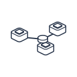</a><br>
        <strong>Multi-Agent Swarm</strong><br>
        <sub><a href="icons/stroke/multi-agent.svg">multi-agent.svg</a></sub>
      </td>
      <td align="center" width="25%">
        <a href="icons/stroke/task.svg"></a><br>
        <strong>Task Card</strong><br>
        <sub><a href="icons/stroke/task.svg">task.svg</a></sub>
      </td>
      <td align="center" width="25%">
        <a href="icons/stroke/goal.svg"></a><br>
        <strong>Goal / Objective</strong><br>
        <sub><a href="icons/stroke/goal.svg">goal.svg</a></sub>
      </td>
    </tr>
    <tr>
      <td align="center" width="25%">
        <a href="icons/stroke/feedback-loop.svg"></a><br>
        <strong>Feedback Loop</strong><br>
        <sub><a href="icons/stroke/feedback-loop.svg">feedback-loop.svg</a></sub>
      </td>
      <td align="center" width="25%">
        <a href="icons/stroke/recursive-loop.svg"></a><br>
        <strong>Recursive Loop</strong><br>
        <sub><a href="icons/stroke/recursive-loop.svg">recursive-loop.svg</a></sub>
      </td>
      <td align="center" width="25%">
        <a href="icons/stroke/reflection.svg"></a><br>
        <strong>Self-Reflection</strong><br>
        <sub><a href="icons/stroke/reflection.svg">reflection.svg</a></sub>
      </td>
      <td align="center" width="25%">
        <a href="icons/stroke/llm.svg"></a><br>
        <strong>Large Language Model</strong><br>
        <sub><a href="icons/stroke/llm.svg">llm.svg</a></sub>
      </td>
    </tr>
    <tr>
      <td align="center" width="25%">
        <a href="icons/stroke/slm.svg"></a><br>
        <strong>Small Language Model</strong><br>
        <sub><a href="icons/stroke/slm.svg">slm.svg</a></sub>
      </td>
      <td align="center" width="25%">
        <a href="icons/stroke/local-model.svg"></a><br>
        <strong>On-device Model</strong><br>
        <sub><a href="icons/stroke/local-model.svg">local-model.svg</a></sub>
      </td>
      <td align="center" width="25%">
        <a href="icons/stroke/training.svg"></a><br>
        <strong>Model Training</strong><br>
        <sub><a href="icons/stroke/training.svg">training.svg</a></sub>
      </td>
      <td align="center" width="25%">
        <a href="icons/stroke/rsi.svg">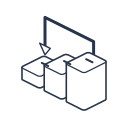</a><br>
        <strong>Recursive Self-Improvement</strong><br>
        <sub><a href="icons/stroke/rsi.svg">rsi.svg</a></sub>
      </td>
    </tr>
    <tr>
      <td align="center" width="25%">
        <a href="icons/stroke/harness.svg">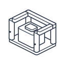</a><br>
        <strong>AI Harness</strong><br>
        <sub><a href="icons/stroke/harness.svg">harness.svg</a></sub>
      </td>
      <td align="center" width="25%">
        <a href="icons/stroke/rag.svg">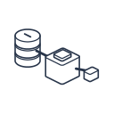</a><br>
        <strong>RAG</strong><br>
        <sub><a href="icons/stroke/rag.svg">rag.svg</a></sub>
      </td>
      <td align="center" width="25%">
        <a href="icons/stroke/vector-database.svg">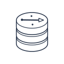</a><br>
        <strong>Vector Database</strong><br>
        <sub><a href="icons/stroke/vector-database.svg">vector-database.svg</a></sub>
      </td>
      <td align="center" width="25%">
        <a href="icons/stroke/tokens.svg">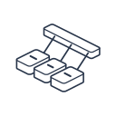</a><br>
        <strong>Tokenization</strong><br>
        <sub><a href="icons/stroke/tokens.svg">tokens.svg</a></sub>
      </td>
    </tr>
    <tr>
      <td align="center" width="25%">
        <a href="icons/stroke/context-window.svg">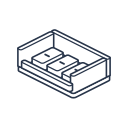</a><br>
        <strong>Context Window</strong><br>
        <sub><a href="icons/stroke/context-window.svg">context-window.svg</a></sub>
      </td>
      <td align="center" width="25%">
        <a href="icons/stroke/reasoning.svg">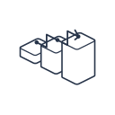</a><br>
        <strong>Reasoning Path</strong><br>
        <sub><a href="icons/stroke/reasoning.svg">reasoning.svg</a></sub>
      </td>
      <td align="center" width="25%">
        <a href="icons/stroke/tools.svg"></a><br>
        <strong>Tool Use</strong><br>
        <sub><a href="icons/stroke/tools.svg">tools.svg</a></sub>
      </td>
      <td align="center" width="25%">
        <a href="icons/stroke/memory.svg"></a><br>
        <strong>Long-term Memory</strong><br>
        <sub><a href="icons/stroke/memory.svg">memory.svg</a></sub>
      </td>
    </tr>
    <tr>
      <td align="center" width="25%">
        <a href="icons/stroke/orchestration.svg"></a><br>
        <strong>Orchestration</strong><br>
        <sub><a href="icons/stroke/orchestration.svg">orchestration.svg</a></sub>
      </td>
      <td align="center" width="25%">
        <a href="icons/stroke/evaluation.svg"></a><br>
        <strong>Evaluation</strong><br>
        <sub><a href="icons/stroke/evaluation.svg">evaluation.svg</a></sub>
      </td>
      <td align="center" width="25%">
        <a href="icons/stroke/alignment.svg"></a><br>
        <strong>Alignment &amp; Safety</strong><br>
        <sub><a href="icons/stroke/alignment.svg">alignment.svg</a></sub>
      </td>
      <td align="center" width="25%">
        <a href="icons/stroke/inference.svg"></a><br>
        <strong>Inference</strong><br>
        <sub><a href="icons/stroke/inference.svg">inference.svg</a></sub>
      </td>
    </tr>
    <tr>
      <td align="center" width="25%">
        <a href="icons/stroke/knowledge-graph.svg">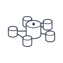</a><br>
        <strong>Knowledge Graph</strong><br>
        <sub><a href="icons/stroke/knowledge-graph.svg">knowledge-graph.svg</a></sub>
      </td>
      <td align="center" width="25%">
        <a href="icons/stroke/prompt.svg"></a><br>
        <strong>Prompt Engineering</strong><br>
        <sub><a href="icons/stroke/prompt.svg">prompt.svg</a></sub>
      </td>
      <td align="center" width="25%">
        <a href="icons/stroke/self-play.svg">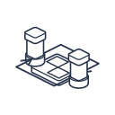</a><br>
        <strong>Self-Play</strong><br>
        <sub><a href="icons/stroke/self-play.svg">self-play.svg</a></sub>
      </td>
      <td align="center" width="25%">
        <a href="icons/stroke/asi-core.svg"></a><br>
        <strong>Superintelligence Core</strong><br>
        <sub><a href="icons/stroke/asi-core.svg">asi-core.svg</a></sub>
      </td>
    </tr>
    <tr>
      <td align="center" width="25%">
        <a href="icons/stroke/monitoring.svg"></a><br>
        <strong>Observability</strong><br>
        <sub><a href="icons/stroke/monitoring.svg">monitoring.svg</a></sub>
      </td>
      <td align="center" width="25%">
        <a href="icons/stroke/mixture-of-experts.svg"></a><br>
        <strong>Mixture of Experts</strong><br>
        <sub><a href="icons/stroke/mixture-of-experts.svg">mixture-of-experts.svg</a></sub>
      </td>
      <td align="center" width="25%">
        <a href="icons/stroke/distillation.svg"></a><br>
        <strong>Model Distillation</strong><br>
        <sub><a href="icons/stroke/distillation.svg">distillation.svg</a></sub>
      </td>
      <td align="center" width="25%">
        <a href="icons/stroke/world-model.svg">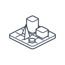</a><br>
        <strong>World Model</strong><br>
        <sub><a href="icons/stroke/world-model.svg">world-model.svg</a></sub>
      </td>
    </tr>
    <tr>
      <td align="center" width="25%">
        <a href="icons/stroke/mcp.svg">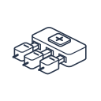</a><br>
        <strong>MCP / Tool Connector</strong><br>
        <sub><a href="icons/stroke/mcp.svg">mcp.svg</a></sub>
      </td>
      <td align="center" width="25%">
        <a href="icons/stroke/skills.svg"></a><br>
        <strong>Agent Skills</strong><br>
        <sub><a href="icons/stroke/skills.svg">skills.svg</a></sub>
      </td>
      <td align="center" width="25%">
        <a href="icons/stroke/computer-use.svg"></a><br>
        <strong>Computer Use</strong><br>
        <sub><a href="icons/stroke/computer-use.svg">computer-use.svg</a></sub>
      </td>
      <td align="center" width="25%">
        <a href="icons/stroke/voice.svg"></a><br>
        <strong>Realtime Voice</strong><br>
        <sub><a href="icons/stroke/voice.svg">voice.svg</a></sub>
      </td>
    </tr>
    <tr>
      <td align="center" width="25%">
        <a href="icons/stroke/multimodal.svg"></a><br>
        <strong>Multimodal</strong><br>
        <sub><a href="icons/stroke/multimodal.svg">multimodal.svg</a></sub>
      </td>
      <td align="center" width="25%">
        <a href="icons/stroke/human-approval.svg">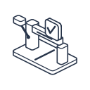</a><br>
        <strong>Human Approval</strong><br>
        <sub><a href="icons/stroke/human-approval.svg">human-approval.svg</a></sub>
      </td>
      <td align="center" width="25%">
        <a href="icons/stroke/sandbox.svg"></a><br>
        <strong>Agent Sandbox</strong><br>
        <sub><a href="icons/stroke/sandbox.svg">sandbox.svg</a></sub>
      </td>
      <td align="center" width="25%">
        <a href="icons/stroke/context-compaction.svg"></a><br>
        <strong>Context Compaction</strong><br>
        <sub><a href="icons/stroke/context-compaction.svg">context-compaction.svg</a></sub>
      </td>
    </tr>
    <tr>
      <td align="center" width="25%">
        <a href="icons/stroke/model-routing.svg"></a><br>
        <strong>Model Routing</strong><br>
        <sub><a href="icons/stroke/model-routing.svg">model-routing.svg</a></sub>
      </td>
      <td align="center" width="25%">
        <a href="icons/stroke/prompt-cache.svg"></a><br>
        <strong>Prompt Cache</strong><br>
        <sub><a href="icons/stroke/prompt-cache.svg">prompt-cache.svg</a></sub>
      </td>
      <td align="center" width="25%">
        <a href="icons/stroke/structured-output.svg">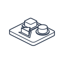</a><br>
        <strong>Structured Output</strong><br>
        <sub><a href="icons/stroke/structured-output.svg">structured-output.svg</a></sub>
      </td>
      <td align="center" width="25%">
        <a href="icons/stroke/citations.svg"></a><br>
        <strong>Citations / Provenance</strong><br>
        <sub><a href="icons/stroke/citations.svg">citations.svg</a></sub>
      </td>
    </tr>
    <tr>
      <td align="center" width="25%">
        <a href="icons/stroke/token-budget.svg"></a><br>
        <strong>Token Budget</strong><br>
        <sub><a href="icons/stroke/token-budget.svg">token-budget.svg</a></sub>
      </td>
      <td align="center" width="25%">
        <a href="icons/stroke/permissions.svg"></a><br>
        <strong>Agent Permissions</strong><br>
        <sub><a href="icons/stroke/permissions.svg">permissions.svg</a></sub>
      </td>
      <td align="center" width="25%">
        <a href="icons/stroke/a2a.svg"></a><br>
        <strong>Agent Communication / A2A</strong><br>
        <sub><a href="icons/stroke/a2a.svg">a2a.svg</a></sub>
      </td>
      <td align="center" width="25%">
        <a href="icons/stroke/synthetic-data.svg"></a><br>
        <strong>Synthetic Data</strong><br>
        <sub><a href="icons/stroke/synthetic-data.svg">synthetic-data.svg</a></sub>
      </td>
    </tr>
  </tbody>
</table>

[View the complete collection contact sheet](previews/stroke-contact-sheet.png)

## Get started

Copy an SVG from your preferred style folder into your project's public assets. Then reference it like any image:

```html

```

In React, the same asset works directly:

```jsx
export function AgentLabel() {
  return (
    <span>
      
      AI agent
    </span>
  );
}
```

Use descriptive alt text for standalone images and `alt=""` when a visible label already identifies the icon. Inline SVGs include accessible names; use `aria-hidden="true"` for decorative instances.

### Browse and export locally

Open the included [index.html](index.html) in your browser from a local copy of this package. The preview works offline and includes:

- Collection filters for Systems and Agents & platforms, plus all five styles.
- Search by concept, product, organization, and Chinese name aliases.
- A detail inspector with 32px, 48px, and 64px samples, product references, and brand asset sources.
- SVG copying and download, plus transparent 512px PNG export.
- Optional hover motion with reduced-motion support.

On GitHub, the HTML link displays its source; download the package or clone the repository to run the preview locally.

### Add a little motion

Copy [motion.css](motion.css) alongside your assets and apply its class:

```html
<link rel="stylesheet" href="/motion.css">
<button aria-label="Open agent">
  
</button>
```

Icons lift 3px on hover or keyboard focus. Motion is disabled when the user requests reduced motion. The exported SVGs are static.

## Design details

| Property | Specification |
| --- | --- |
| Canvas | `128 × 128` viewBox |
| Projection | 45° azimuth, 30° elevation |
| Padding | Approximately 17px minimum |
| Edges | Rounded joins; 1.6px outer strokes and 1.25px surface seams |
| Lighting | Top-left, expressed through flat face colors |
| Palette | Electric blue `#00A3FF`, purple `#A58BEF`, teal `#47C5B3`, coral `#F48C76`; brand marks use their reference colors in Color |
| Suggested sizes | 48–128px; use larger sizes for detailed concepts |
| Background | Transparent, with opaque object faces |
| Dependencies | No fonts, raster images, external assets, or runtime scripts in the SVGs |

Stroke weights scale with the viewBox. Stroke uses white faces to hide rear geometry. Fill separates faces with slate tones and omits exterior outlines. No gradients, filters, or heavy shadows.

## Inside the package

| Path | Contents |
| --- | --- |
| [icons/](icons/) | 340 SVGs organized into five style folders |
| [brand/](brand/) | SuperIntelligence wordmark and robotic-brain octopus, with light, dark, and monochrome SVGs |
| [README.md](README.md) and `README-{style}.md` | Complete, cross-linked galleries for each of the five styles |
| [index.html](index.html) | Standalone offline preview and exporter |
| [previews/](previews/) | SVG and PNG sheets of the complete collection |
| [manifest.json](manifest.json) | Names, descriptions, collections, product metadata, palette, camera, and asset paths |
| [BRAND-REFERENCES.md](BRAND-REFERENCES.md) | Product references, vector sources, and artwork terms for the 20 agents and platforms |
| [motion.css](motion.css) | Optional hover and focus motion |
| [src/](src/) | Editable geometry, renderer, and preview template |
| [scripts/](scripts/) | Build, validation, and packaging commands |

## Customize and rebuild

Requires Node.js 20.10+ and Python 3. No `npm install` is needed.

```sh
npm run build   # Regenerate SVGs, SVG sheets, manifest, preview, and style READMEs
npm run check   # Validate all 340 SVGs
npm run pack    # Create superintelligence-icons.zip
```

Edit the system geometry in [icons-core.mjs](src/icons-core.mjs), [icons-models.mjs](src/icons-models.mjs), [icons-systems.mjs](src/icons-systems.mjs), [icons-capabilities.mjs](src/icons-capabilities.mjs), or [icons-operations.mjs](src/icons-operations.mjs). Named products live in [icons-brands-featured.mjs](src/icons-brands-featured.mjs), [icons-brands-global.mjs](src/icons-brands-global.mjs), and [icons-brands-china.mjs](src/icons-brands-china.mjs), with shared geometry in [brand-kit.mjs](src/brand-kit.mjs).

Change materials and style mapping in [scene.mjs](src/scene.mjs). Edit source modules rather than generated files to preserve your changes across builds.

The product name is **SuperIntelligence**, with a robotic-brain octopus between **Super** and **Intelligence**. Its exposed cortex, camera optics, and eight articulated metal arms represent intelligence, perception, and coordinated action. Edit the artwork in [identity-robot.mjs](src/identity-robot.mjs) and [identity-arms.mjs](src/identity-arms.mjs), or the font-free vector lettering in [scripts/brand.mjs](scripts/brand.mjs); the build regenerates every logo asset.

Edit [README.md](README.md) to update the shared documentation. The [README generator](scripts/readmes.mjs) uses it as the Color source and creates the four suffixed style galleries; run it directly with `node scripts/readmes.mjs` or as part of the build.

The included PNG sheets are snapshots of the delivered version. You can also serve the preview with `npm run preview` and open `http://localhost:8080`.

## License and credits

The 48 original AI system icons and the package's original source and isometric presentation are available under the [MIT license](LICENSE). Third-party brand marks retain their owners' rights and source terms; they are not relicensed by this package. See [BRAND-REFERENCES.md](BRAND-REFERENCES.md) for individual sources. No endorsement or trademark rights are implied.

Projection and geometry helpers use Ryan's Anatomy toolkit, included with its [MIT license](vendor/anatomy/LICENSE). Overflow Design informed the general isometric direction.

<!-- style-navigation:start -->
**Browse styles:** [**Stroke**](README-stroke.md) · [Two-tone](README-two-tone.md) · [Duotone](README-duotone.md) · [Fill](README-fill.md) · [Color](README.md)
<!-- style-navigation:end -->
