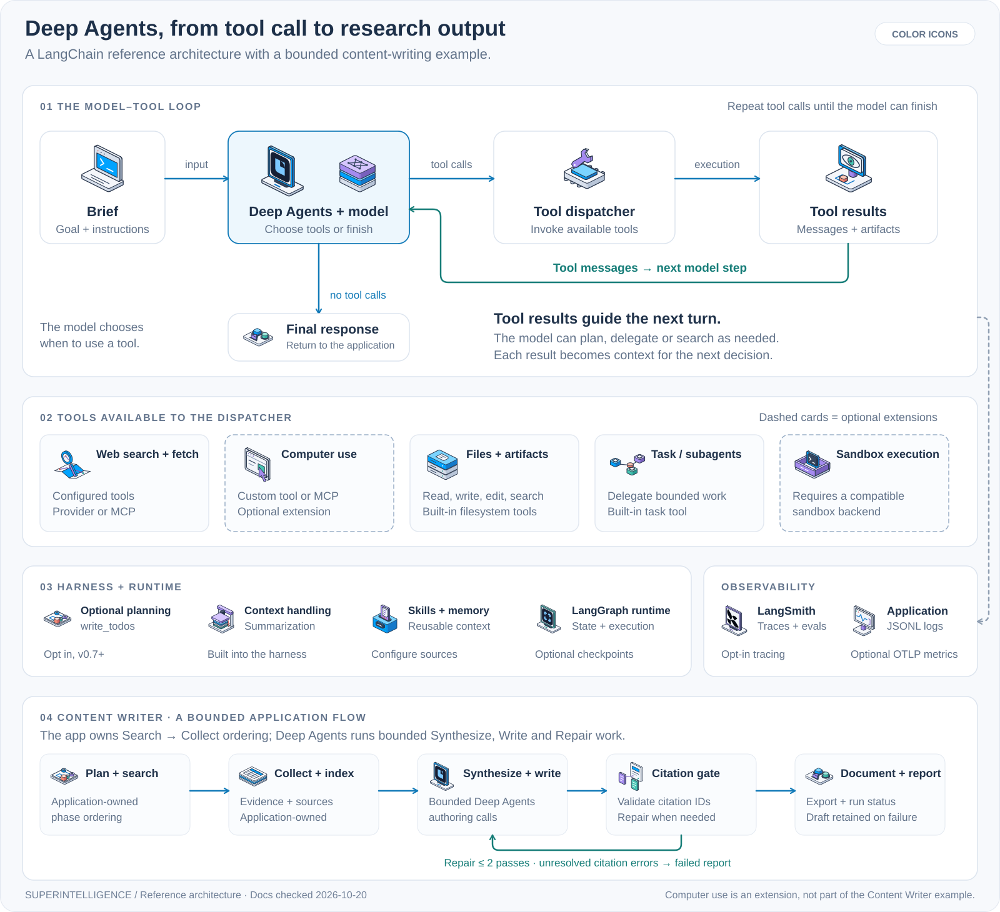

# Deep Agents research and tool loop

This diagram combines the documented LangChain Deep Agents model/tool loop with a concrete research-and-writing example. Documentation was checked on **2026-10-20**. The example is pinned to [Deep-Research-Content-Writer at `4dfeada`](https://github.com/josoroma/Deep-Research-Content-Writer/tree/4dfeada0df0b1e36178e5403aff4dabf73dac08b).



| Style | Vector | Image |
| --- | --- | --- |
| Color | [SVG](diagrams/color/deep-agent-research.svg) | [PNG](diagrams/color/deep-agent-research.png) |
| Stroke | [SVG](diagrams/stroke/deep-agent-research.svg) | [PNG](diagrams/stroke/deep-agent-research.png) |
| Two-tone | [SVG](diagrams/two-tone/deep-agent-research.svg) | [PNG](diagrams/two-tone/deep-agent-research.png) |
| Duotone | [SVG](diagrams/duotone/deep-agent-research.svg) | [PNG](diagrams/duotone/deep-agent-research.png) |
| Fill | [SVG](diagrams/fill/deep-agent-research.svg) | [PNG](diagrams/fill/deep-agent-research.png) |

## Reading the architecture

The model chooses tool calls, the runtime executes them, and the results return to the model as context for its next turn. The loop ends when the model returns a final response. Planning, evaluation, and review can be part of an application's workflow; they are not fixed nodes that run after every tool call. [LangChain agent loop](https://docs.langchain.com/oss/python/langchain/agents)

The tool palette shows capabilities an application can expose. Computer use is an illustrative custom tool or MCP integration. LangSmith and application logs receive execution telemetry alongside the control flow. [Deep Agents tools](https://docs.langchain.com/oss/python/deepagents/tools), [event streaming](https://docs.langchain.com/oss/python/deepagents/event-streaming)

| Component | Default or configuration requirement | Source |
| --- | --- | --- |
| Files and artifacts | Filesystem middleware provides tools such as `read_file`, `write_file`, and `edit_file`; storage behavior depends on the backend. | [Customization](https://docs.langchain.com/oss/python/deepagents/customization#deep-agents-stack) |
| Subagents | The `task` tool supports delegation; applications configure specialist agents and their tools. | [Subagents](https://docs.langchain.com/oss/python/deepagents/subagents) |
| Context management | The harness summarizes growing history and offloads large tool results. | [Deep Agents overview](https://docs.langchain.com/oss/python/deepagents/overview) |
| Planning | In v0.7+, explicitly add `TodoListMiddleware()` to provide `write_todos`. | [Task planning](https://docs.langchain.com/oss/python/deepagents/overview#task-planning) |
| Search and computer use | Supply functions, LangChain tools, or MCP tools through `tools=`. The diagram's computer-use adapter is a proposed extension of the example. | [Tools](https://docs.langchain.com/oss/python/deepagents/tools) |
| Shell execution | `execute` requires a backend implementing sandbox execution. | [Sandboxes](https://docs.langchain.com/oss/python/deepagents/sandboxes) |
| Memory and skills | Configure `memory=` and `skills=` to load project guidance and reusable instructions. | [Customization](https://docs.langchain.com/oss/python/deepagents/customization#deep-agents-stack) |
| Persistent state | Configure a checkpointer for thread state and a store for cross-thread data, or use managed persistence through Agent Server. | [LangGraph persistence](https://docs.langchain.com/oss/python/langgraph/persistence) |
| LangSmith | Enable tracing separately. Evaluations can score selected production runs or offline datasets. | [Tracing](https://docs.langchain.com/langsmith/observability-quickstart), [evaluation](https://docs.langchain.com/langsmith/evaluation) |
| Logs and progress | Application middleware or event consumers record progress, tool events, errors, and artifacts. | [Customization](https://docs.langchain.com/oss/python/deepagents/customization), [event streaming](https://docs.langchain.com/oss/python/deepagents/event-streaming) |

## The Content Writer example

The application owns phase ordering: **plan/search → collect/index → synthesize → write → citation gate → document and run report**. It derives query variants with a model, then calls registered search and corpus tools; Deep Agents handles bounded synthesis, writing, and repair. [Run orchestration](https://github.com/josoroma/Deep-Research-Content-Writer/blob/4dfeada0df0b1e36178e5403aff4dabf73dac08b/application/run_service.py#L194-L234), [query generation](https://github.com/josoroma/Deep-Research-Content-Writer/blob/4dfeada0df0b1e36178e5403aff4dabf73dac08b/workflows/search_run.py#L65-L80), [authoring pipeline](https://github.com/josoroma/Deep-Research-Content-Writer/blob/4dfeada0df0b1e36178e5403aff4dabf73dac08b/services/authoring_pipeline.py#L80-L139)

- **Agent harness:** `create_deep_agent`, explicit `TodoListMiddleware`, a checkpointer, an immutable-source filesystem backend, and search/research/analyst/writer specialists. The default general-purpose subagent is disabled. [Agent construction](https://github.com/josoroma/Deep-Research-Content-Writer/blob/4dfeada0df0b1e36178e5403aff4dabf73dac08b/agents/deep_research.py#L35-L129)
- **Web evidence:** `plan_search`, `google_search`, and `normalize_results`; providers are SerpApi or Serper. `collect_source` fetches and extracts source Markdown, and `build_index` creates the source index. [Search tools](https://github.com/josoroma/Deep-Research-Content-Writer/blob/4dfeada0df0b1e36178e5403aff4dabf73dac08b/tools/search_tools.py#L70-L97), [corpus tools](https://github.com/josoroma/Deep-Research-Content-Writer/blob/4dfeada0df0b1e36178e5403aff4dabf73dac08b/tools/corpus_tools.py#L91-L162)
- **Citation repair:** at most two repair passes. This validates citation identity; it does not establish that every claim is supported. The run report records the outcome, including unresolved failures. [Repair loop](https://github.com/josoroma/Deep-Research-Content-Writer/blob/4dfeada0df0b1e36178e5403aff4dabf73dac08b/services/authoring_pipeline.py#L195-L226), [documented limitation](https://github.com/josoroma/Deep-Research-Content-Writer/blob/4dfeada0df0b1e36178e5403aff4dabf73dac08b/README.md#L161-L165)
- **Observability:** opt-in LangSmith traces; local JSONL execution logs and a telemetry summary; optional OTLP metrics with a Prometheus/Grafana stack. [Tracing](https://github.com/josoroma/Deep-Research-Content-Writer/blob/4dfeada0df0b1e36178e5403aff4dabf73dac08b/services/observability.py#L155-L204), [execution logs](https://github.com/josoroma/Deep-Research-Content-Writer/blob/4dfeada0df0b1e36178e5403aff4dabf73dac08b/services/execution_log.py#L12-L58), [metrics](https://github.com/josoroma/Deep-Research-Content-Writer/blob/4dfeada0df0b1e36178e5403aff4dabf73dac08b/services/run_metrics.py#L17-L25)
- **Computer use:** an extension shown in the reference architecture. The pinned repository does not configure a browser or desktop automation tool.

## Reuse the image

The SVG embeds the library's actual icon paths, labels, and connectors. It has no external images or scripts. Copy it into your documentation and use a relative Markdown image link:

```markdown

```

Edit [the diagram generator](../scripts/deep-agent-diagram.mjs), then run `npm run build`. All five SVGs are generated from the same layout. PNGs are snapshots of the delivered SVGs. The [main README](../README.md#deep-agents-research-and-tool-loop) and the four style READMEs display their matching variants.

Original diagram layout and system icons use the repository's [MIT license](../LICENSE). Included product marks retain their source terms; see [brand references](../BRAND-REFERENCES.md).
